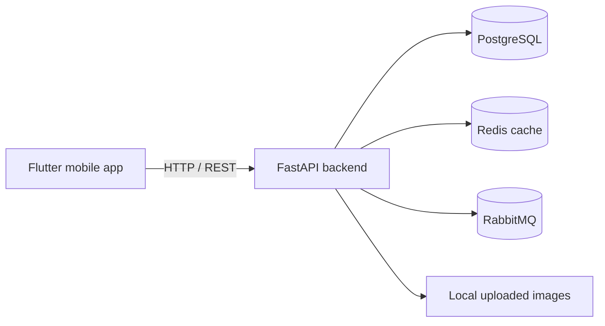

<div align="center">

# Stayzi

**A Flutter + FastAPI accommodation marketplace prototype**

Flutter · Dart · FastAPI · PostgreSQL · SQLAlchemy · Redis · RabbitMQ · Docker

A collaborative university full-stack project by **Team Syntax Terror**.

[Watch the project presentation](https://youtu.be/BRXBHr3zPQE) · [Original project overview (Turkish)](docs/ORIGINAL_README_TR.md)

</div>

## Overview

Stayzi is a university team project inspired by accommodation marketplaces. It explores the experience of searching for places to stay, viewing property details, managing listings and profile information, saving favorites, and working with booking-related flows through a Flutter mobile frontend and a Python/FastAPI backend.

**Project status:** Educational prototype. This repository is not presented as a live commercial booking platform. Some screens and integrations may require additional configuration or testing; payment processing should not be assumed production-ready.

## Preview

[](https://youtu.be/BRXBHr3zPQE)

[Project presentation and video](Sunum.md) · [Frontend documentation](Front-End.md) · [Backend documentation](Back-End.md)

## Features explored

- **Accounts and profiles:** Login/registration flows, profile display and editing, account deactivation, and profile photos.
- **Accommodation listings:** Listing creation, editing, deletion, detail pages, and image uploads.
- **Search and discovery:** Property browsing, filtering, dates, locations, and property details.
- **Favorites and reviews:** Saved listings and user feedback interfaces.
- **Booking flows:** Booking and availability-related UI and API modules.
- **Backend integrations:** REST API design, PostgreSQL persistence, Redis caching, RabbitMQ integration, and Docker-based local service configuration.

These are features and modules represented in the codebase and team documentation. Their presence does not imply production-grade security, end-to-end completion, or real-money payment support.

## Tech stack

| Layer | Technologies |
| --- | --- |
| Mobile app | Flutter, Dart |
| Mobile networking | `http` |
| Maps and location | `flutter_map`, `latlong2`, `geolocator`, `geocoding` |
| Backend | Python, FastAPI, Pydantic |
| Database | PostgreSQL, SQLAlchemy, Alembic |
| Caching | Redis |
| Messaging | RabbitMQ, Pika |
| Development environment | Docker, Docker Compose |
| Automation | GitHub Actions workflow in the repository |

The CI workflow exists as a historical project artifact; this README does **not** claim that automated tests are currently passing.

## High-level architecture



### Code organization

```text
stayzi_ui/
  lib/
    screens/       # Onboarding, search, listings, profile, favorites
    models/        # Mobile data models
    services/      # API client, local storage and location services

backend_fastapi/
  app/
    routers/       # Auth, users, listings, favorites, bookings, reviews
    models/        # SQLAlchemy entities
    schemas/       # API request/response models
    services/      # Supporting backend logic
    middleware/    # Request middleware
  alembic/         # Database migrations
  requirements.txt
  docker-compose.yml
```

## My contributions — Ahmet Koca

As a **full-stack team member**, I worked on both Flutter screens and FastAPI features related to:

- Profile display and personal-information editing
- Account logout and deactivation flows
- Profile and listing photo uploads
- Adding, editing, viewing, and deleting the user's accommodation listings
- Listing details accessed from favorites
- Redis and RabbitMQ backend integration work

The breakdown above is based on the original [backend](Back-End.md) and [frontend](Front-End.md) responsibility documents. The project was built collaboratively, and other features were implemented by teammates.

## Running locally

> **Security first:** The historical repository includes committed development configuration containing credentials. **Do not reuse those credentials.** Replace any still-active secrets and review the [security hardening pull request](https://github.com/AhmetKoca32/Stayzi/pull/77) before attempting Docker-based setup or deploying anything. Deleting a file in a new commit does not remove it from Git history.

### Flutter app

Use a Flutter SDK compatible with the Dart constraint declared in `stayzi_ui/pubspec.yaml` (currently `^3.7.2`):

```bash
git clone https://github.com/AhmetKoca32/Stayzi.git
cd Stayzi/stayzi_ui
flutter pub get
flutter run
```

The API URL is configured in `stayzi_ui/lib/services/api_constants.dart`. The app requires a correctly configured and running backend to exercise network-backed features.

### FastAPI backend

From the repository root:

```bash
cd backend_fastapi
python -m venv .venv
source .venv/bin/activate
pip install -r requirements.txt
uvicorn app.main:app --reload
```

On Windows, use the platform-specific virtual environment activation command.

To connect to the database and supporting services, provide **new local credentials** through environment variables, and use an isolated development setup. The backend's historical dependency list contains overlapping Redis constraints and may need cleanup before it installs successfully. The commands above are a starting point, **not** a verified clean-room installation.

### Useful checks

```bash
# From stayzi_ui/
flutter analyze

# From backend_fastapi/ with the backend running
# Check the local API root in your browser:
# http://127.0.0.1:8000/
```

No passing test suite, deployed service, or security certification is claimed.

## Project documentation

The original university documentation remains available:

- [Original Turkish overview](docs/ORIGINAL_README_TR.md)
- [Requirements analysis](Gereksinim-Analizi.md)
- [State diagram](Durum-Diyagramı.md)
- [State scenarios](Durum-Senaryoları.md)
- [Flutter / frontend responsibilities](Front-End.md)
- [FastAPI / backend responsibilities](Back-End.md)
- [Project presentation](Sunum.md)

## Team

**Syntax Terror:** İclal Karahisar, İlayda Çelikkaya, Ömer Faruk Yılmaz, and **Ahmet Koca**.

Stayzi was a collaborative learning project. The original code and documentation are preserved as a record of the team's development experience.
